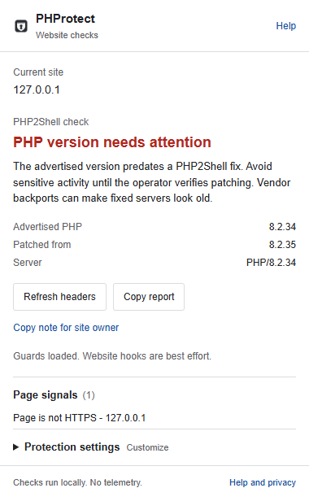
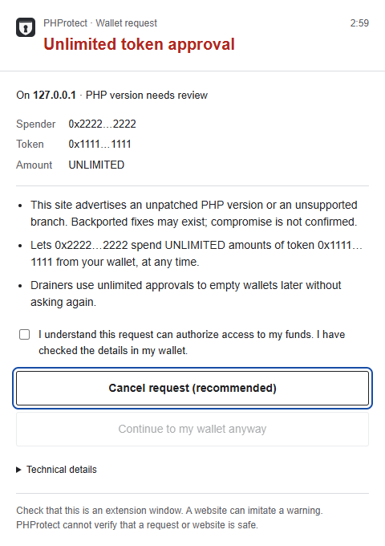

# PHProtect

Local PHP2Shell version checks and best-effort guards for sensitive website actions.

**PHProtect cannot patch a PHP server or make a compromised website safe.** It adds evidence and review prompts; it is not a security certification. Chrome is the primary target. A Firefox package is provided for evaluation and still needs live Firefox testing and AMO review.

## Distribution status

**PHProtect 1.1.1 was submitted to the Chrome Web Store for review on 22 October 2026.** The developer dashboard confirms **Pending review**. It is not approved or available from the store yet; automatic publication is enabled after approval. The source and downloadable packages are public now. Install from the release ZIP using the instructions below.

[Download the Chrome build](https://github.com/yananai-chiwuta/PHProtect/releases/latest/download/phprotect-chrome.zip) | [All releases and checksums](https://github.com/yananai-chiwuta/PHProtect/releases/latest) | [Project website](https://yananai-chiwuta.github.io/PHProtect/) | [Privacy policy](https://yananai-chiwuta.github.io/PHProtect/privacy.html)

## Screenshots

Actual extension interfaces using inert local test data. No real wallet, account or attack is shown.



<details>
<summary>Wallet request review window</summary>



</details>

## What it does

| Feature | Behavior | Important limit |
| --- | --- | --- |
| PHP2Shell awareness | Reads top-level response headers and compares advertised PHP versions with bundled advisory data. | Headers can be hidden, forged, stale or served by a proxy. Vendor backports can make fixed servers look old. |
| Page signals | Checks for common patterns such as insecure password forms, lookalike hostnames and ClickFix wording. | Heuristics produce false positives and miss attacks. Ordinary embeds and cross-site forms can trigger findings. |
| Recovery phrase checks | Detects English BIP39-like text in supported fields; stops some input or clears text and offers explicit restoration. | A page may already have observed words. Other languages, custom editors, closed shadow roots and programmatic changes may bypass detection. No checksum validation. |
| Wallet request review | Classifies supported Ethereum provider calls, including common approvals, permits, signing and network requests. | Page-world hooks can be bypassed or interfered with. This is not transaction simulation, wallet verification or protection for every provider or chain. |
| Clipboard command checks | Replaces recognized commands copied through intercepted APIs with a warning. | It cannot cover every clipboard path or malicious command. Some visible installation examples are deliberately allowed. Clipboard reads are logged as attempts, not blocked. |
| Decision windows | Cancel by default; high-risk continuation requires acknowledgement. One queued window per tab, including frames. | A site can imitate a warning visually. Requests that bypass hooks never reach this flow. Closing, expiry or a missing response denies intercepted requests. |
| Refresh headers | Explicit HEAD request to the current page; GET only on 405/501. No cookies, no redirects. | Up to two requests. Site logs still see your IP and URL. A logged-out response may differ from the page. |

A version meeting the cutoff is described as evidence only. Unknown or future PHP branches stay unknown. Page warnings remain visible even if the PHP header meets a cutoff. An old version does **not** prove compromise.

PHP2Shell is the name used for CVE-2026-109618 and CVE-2026-109619. PHP's [official advisory](https://www.php.net/archive/2026.php#2026-10-21-5) lists 8.2.35, 8.3.36, 8.4.27 and 8.5.12 as fixed upstream releases, and source backports for some older branches. The running web runtime and vendor package must be verified by its operator.

Advisory data last checked: **22 October 2026**. Rules are bundled and do not refresh remotely. They can become outdated between releases.

## Install and use

### Chrome: install the published release

No Python, Node.js or build tools are needed for this method.

1. Download **[phprotect-chrome.zip](https://github.com/yananai-chiwuta/PHProtect/releases/latest/download/phprotect-chrome.zip)** from the official release. Optional: verify it against [SHA256SUMS](https://github.com/yananai-chiwuta/PHProtect/releases/latest/download/SHA256SUMS).
2. Extract the ZIP into a permanent folder. On Windows, right-click the ZIP and choose **Extract All**. Keep the extracted files after installation.
3. Open `chrome://extensions` in Chrome and turn on **Developer mode**.
4. Click **Load unpacked**, then select the extracted folder containing `manifest.json`. Select the folder, not the ZIP file.
5. Pin PHProtect from Chrome's extensions menu and reload websites that were already open. Open the popup to see PHP evidence, page signals and whether guards loaded.
6. Expand **Protection settings** to change global checks or exact-hostname wallet exceptions. **Help and privacy** explains the limits and can restore defaults and clear exceptions.

Unpacked installations are developer installations and do not update through the Chrome Web Store. To update, download and extract a new release into the same folder and click **Reload** on PHProtect's entry in `chrome://extensions`. Browser warnings about Developer mode are expected; install only packages whose source and publisher you trust.

### Build from source

Requirements: Python 3.10+ for packaging. There are no runtime npm dependencies.

```sh
git clone https://github.com/yananai-chiwuta/PHProtect.git
cd PHProtect
python build.py
```

Load `dist/phprotect-chrome` using **Load unpacked** as described above. To remove PHProtect, click **Remove** on its entry in `chrome://extensions`.

### Firefox: experimental evaluation

Download [phprotect-firefox.zip](https://github.com/yananai-chiwuta/PHProtect/releases/latest/download/phprotect-firefox.zip) and extract it, or build from source. In Firefox visit `about:debugging#/runtime/this-firefox`, choose **Load Temporary Add-on**, and select `manifest.json` from the extracted Firefox folder. Temporary installation expires with the browser session. This build is unsigned and still needs live Firefox validation; normal distribution requires Mozilla signing.

HTTP and HTTPS pages are supported. Browser pages, extension stores, some PDFs and other protected documents restrict extensions. Incognito and file URLs are not enabled by default. Restricting site access in browser settings reduces coverage. A version warning is evidence to investigate, not proof that a site is compromised.

## Privacy and permissions

No accounts, developer backend, telemetry, analytics, remote code or remote rules. All inspection runs locally. The extension accesses some page text, form values, clipboard writes and wallet parameters for the features above, so it requires broad website access. It does not claim to have no access to sensitive data.

- `webRequest`: observes top-level navigation headers. No request-blocking permission.
- `storage`: per-tab session evidence plus local preferences and hostname exceptions.
- `http://*/*` and `https://*/*`: necessary for automatic checks across ordinary websites. No access on restricted pages.
- No history, downloads, clipboard, native-messaging or tabs permission. Host permissions still expose tab URLs needed for checks; the background queries tabs to distribute settings.

Detected seed words and clipboard text are not sent to the background or persisted by the extension. Short findings and activity codes remain in session storage; exact-hostname exceptions remain in local storage until reset or uninstall. Refreshing headers and copying a report are explicit actions with the effects described above. Read [PRIVACY.md](PRIVACY.md) and [THREAT-MODEL.md](THREAT-MODEL.md).

## Inspect, test and reproduce

The extension consists of formatted JavaScript, HTML, CSS, JSON and PNG icons. There is no bundler, minification, obfuscation, eval, telemetry SDK, runtime npm dependency or remotely hosted executable code. The ZIP contains the same runtime files as `src/`, a generated manifest and required legal notices. You can inspect every decision rule in `src/rules.js` and every warning template in `src/background.js`.

```sh
node tools/test.cjs
python -m unittest discover -s tests -p "test_*.py"
python build.py
```

Node 18+ is required for unit tests. Browser tests use the optional development dependency in `package.json`:

```sh
npm ci
npx playwright install chromium
npm run test:browser
```

Browser tests load the actual unpacked Chrome extension against inert local fixtures. They never connect a real wallet or execute clipboard commands. Screenshots go to `.test-output/`. They establish only the scenarios exercised, not universal protection.

A complete inspectable source archive is also generated as `dist/phprotect-source.zip`. Build twice without changing inputs and compare `dist/SHA256SUMS`. ZIP file ordering, timestamps, permissions and paths are normalized. Packaging uses only Python's standard library. Icon regeneration is optional and requires Pillow.

## Project policy and license

**No pull requests will be accepted.** This is a maintainer-controlled project. The included GitHub workflow automatically closes pull requests. Non-sensitive bug reports are welcome; see [CONTRIBUTING.md](CONTRIBUTING.md). Sensitive reports should follow [SECURITY.md](SECURITY.md).

**Anyone may fork, modify and redistribute PHProtect, including commercially, under the MIT license.** Keep the applicable license and attribution notices. Your fork does not have to send changes back. No review, support, response time or security warranty is promised. See [LICENSE](LICENSE), [NOTICE](NOTICE) and `third_party/`. Required third-party attribution is confined to those legal materials.

See [store/RELEASE.md](store/RELEASE.md) for store listing copy, privacy disclosures, reviewer instructions, release checks and publication steps still requiring the maintainer's accounts and public URLs.
